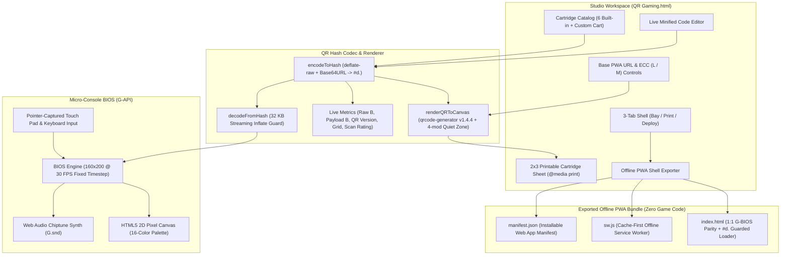
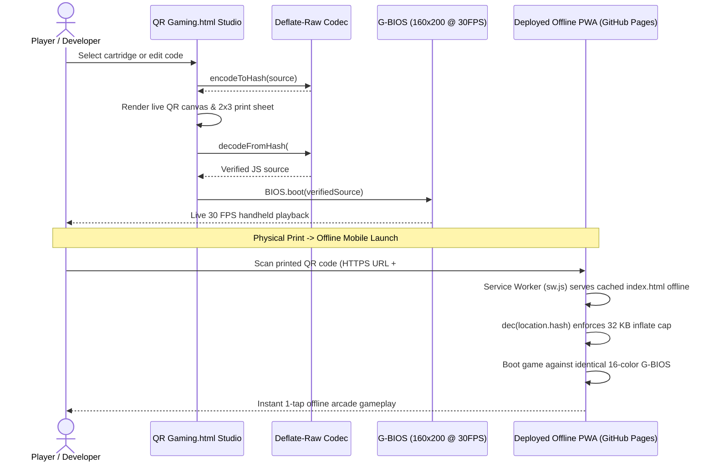

# Architecture Overview

> **Project**: QR Cartridge Arcade — 6-Game Offline PWA Studio & Handheld  
> **Copyright**: © 2026 NazreenNasyuha — Licensed under the [MIT License](LICENSE)

---

## 1. Application Summary

- **Purpose**: A self-contained, zero-backend retro micro-console studio and handheld emulator that compiles entire playable JavaScript arcade games into compressed URL fragments (`#d.<base64url>`), encodes them as scannable QR codes, generates printable 2×3 Game Boy–style physical cartridge sheets, and exports a minimal zero-game-code Offline PWA shell (`index.html`, `sw.js`, `manifest.json`) capable of booting any printed QR cartridge in Airplane Mode.
- **Tech Stack**:
  - **Runtime**: Vanilla HTML5, CSS3, Modern ES2020+ JavaScript (Zero build step, zero backend).
  - **Graphics & Audio**: HTML5 2D Canvas (`160×200` logical resolution, nearest-neighbor pixelated scaling) + Web Audio API oscillator synthesizer (`square`, `triangle`, `sawtooth`).
  - **Compression**: Native browser `CompressionStream` / `DecompressionStream` (`deflate-raw`) with Base64URL encoding (`#d.`) and URI-encoded fallback (`#r.`).
  - **Styling & Typography (Studio only)**: Tailwind CSS Play CDN + Google Fonts (`Inter`, `JetBrains Mono`, `Silkscreen`). The exported Offline PWA shell has **zero external dependencies**.
  - **QR Encoding (Studio only)**: `qrcode-generator@1.4.4` (Type 0 auto-version, Byte mode, ECC `L` / `M`).
- **Entry Points**:
  - [`QR Gaming.html`](QR%20Gaming.html) — Complete interactive Studio, live handheld console, QR telemetry generator, live code editor, printable 2×3 sheet generator, and Offline PWA exporter (pre-configured for `https://nazreennasyuha.github.io/QR-Code-Gaming/`).
  - [`index.html`](index.html), [`sw.js`](sw.js), [`manifest.json`](manifest.json) — Deployed root Offline PWA shell (~7.5 KB zero-game-code BIOS shell + cache-first Service Worker + Web App Manifest) with exact 1:1 parity to the Tab 3 exporter in `QR Gaming.html`.

---

## 2. Folder & File Map

```text
QR Code Gaming/
├── .gitattributes           # Line-ending normalization rules
├── .gitignore               # Secret, OS, IDE, build, and local export exclusions
├── AGENTS.md                # Team engineering standards, invariants, and security guardrails
├── ARCHITECTURE.md          # Living architecture specification (single source of truth)
├── LICENSE                  # MIT License — Copyright (c) 2026 NazreenNasyuha
├── README.md                # GitHub repository overview & GitHub Pages setup guide
├── QR Gaming.html           # Self-contained Studio, 16-color G-BIOS, 6+1 cartridges & PWA exporter
├── index.html               # Standalone zero-game-code Offline QR Pocket Console (GitHub Pages root)
├── sw.js                    # Cache-first Service Worker for Airplane Mode offline play
└── manifest.json            # Installable PWA Web App Manifest
```

---

## 3. System Architecture Diagrams

### 3.1 Component & Data-Flow Architecture



### 3.2 Round-Trip Hash Verification & Offline QR Scan Lifecycle



---

## 4. Core Components & Workflows

### 4.1 Unified 16-Color Micro-Console BIOS (`G`)
Both the Studio handheld (`QR Gaming.html`) and the exported standalone PWA (`PWA_INDEX_HTML`) implement an **exact 1:1 parity** BIOS runtime at `160×200` logical pixels and `30 FPS` fixed timestep (`STEP = 1000/30`, max 2 catch-up frames per RAF tick):

| API Member | Signature / Value | Responsibility |
| --- | --- | --- |
| `G.c` | `CanvasRenderingContext2D` | Raw 2D canvas context for advanced drawing |
| `G.W`, `G.H` | `160`, `200` | Fixed logical viewport dimensions |
| `G.pal` | `string[16]` | 16-color Catppuccin-inspired retro palette (`0..15`) |
| `G.k` | `{ u, d, l, r, a, b }` | Held button state (boolean/truthy) |
| `G.p` | `{ u, d, l, r, a, b }` | Edge-triggered single-frame press state (cleared every tick) |
| `G.cls(col)` | `(col = 0) => void` | Clears full `160×200` framebuffer with palette index or CSS color |
| `G.r(x, y, w, h, col)` | `(number, number, number, number, number\|string) => void` | Integer-aligned filled rectangle primitive |
| `G.t(str, x, y, col, sz)` | `(string, number, number, number\|string = 3, number = 8) => void` | Monospace bitmap-style text renderer |
| `G.snd(freq, dur, type)` | `(number, number = 0.06, OscillatorType = 'square') => void` | Web Audio API chiptune tone generator (respects mute state) |
| `G.sc(pts)` | `(number) => void` | Updates score register and console HUD badge |
| `G.ov(msg)` | `(string = 'GAME OVER') => void` | Triggers Game Over overlay with 12-frame reboot debounce lock |
| `G.loop(fn)` | `((frame: number) => void) => void` | Registers the per-frame update/render callback |

### 4.2 Compression Codec & QR Density Budgets
- **Primary Wire Format (`#d.`)**: Raw DEFLATE (`CompressionStream('deflate-raw')`) encoded as unpadded Base64URL (`+` → `-`, `/` → `_`, `=` stripped).
- **Fallback Wire Format (`#r.`)**: Plain `encodeURIComponent` when `CompressionStream` is unavailable.
- **Scan Rating Thresholds** (Full URL = `Base PWA URL + #d.<payload>`):
  - **Easy Scan**: `< 900 B` (green)
  - **Good Scan**: `900 B – 1,399 B` (amber)
  - **Dense**: `>= 1,400 B` (rose)
- **Quiet Zone**: Pure `#000000` modules on `#FFFFFF` with a strict 4-module quiet zone for reliable mobile camera focus.

### 4.3 Built-In Cartridge Catalog (`CARTRIDGE_CATALOG`)
1. **SNAKE** (`snake`): 16×18 grid, queued inputs, timed bonus berry, hold-`A` turbo speed.
2. **PONG** (`pong`): Portrait court vs. scaling CPU AI, dash/power-hit (`A`), sets to 7 with level progression.
3. **TETRIS** (`tetris`): 10×20 board, 7 tetrominoes with wall-kick rotation, ghost piece, next preview, hard/soft drop.
4. **SPACE INVADERS** (`invaders`): 5×8 alien formation with dynamic cadence, destructible shields, multi-wave progression.
5. **COLUMNS** (`columns`): 6×13 gem well, vertical/horizontal/diagonal match-3+, cascading chain multipliers.
6. **BOMBERMAN** (`bomberman`): 11×11 destructible arena, chain-detonating cross blasts, roaming enemies, multi-stage clear.
7. **CUSTOM CART** (`custom`): Starter *Star Collector* template; editable live in Tab 1 with instant QR telemetry updates.

### 4.4 Workspace Tabs
- **Tab 1 — Play & QR Bay**: Cartridge selector grid, sculpted pocket handheld with pointer-captured touch controls + keyboard bindings (`Arrows`/`WASD`, `Z`/`Space`/`Enter`=`A`, `X`/`Shift`=`B`, `R`=Reset), live QR card with PNG/URL/payload export, Base URL & ECC controls, and expandable minified code editor.
- **Tab 2 — Printable QR Sheet**: Renders all 6 built-in cartridges in a crisp 2×3 Game Boy–inspired card grid with dedicated `@media print` stylesheet (hides dark studio chrome, prints pure white cards with `print-color-adjust: exact`).
- **Tab 3 — Offline PWA Deploy**: Displays exact byte size, syntax preview, clipboard copy, and direct download for `index.html`, `sw.js`, and `manifest.json`.

---

## 5. Security Architecture & Threat Model

Because the fundamental architecture executes JavaScript carried inside a QR URL fragment (`new Function('G', code)(G)`), strict defense-in-depth boundaries are enforced:

1. **Untrusted Hash Execution Boundary (Critical Threat Model)**:
   - **Studio (`QR Gaming.html`)**: Opening the Studio with an incoming `#d.` or `#r.` URL hash **never auto-executes** the payload. Instead, the decoded source is placed into the `Custom Cart` editor, the editor drawer opens automatically, and an amber warning requires the developer to inspect the code and explicitly click **Apply & Re-Encode**.
   - **Deployed PWA (`index.html`)**: Designed for 1-tap offline game launching from trusted printed QR cards. **Deployment Rule**: Always host the exported PWA on a **dedicated, static-only origin** (e.g., an isolated GitHub Pages site) with **zero cookies, zero authentication tokens, zero `localStorage` secrets, and zero backend APIs**. Never co-host on a domain shared with authenticated web apps.
2. **Decompression Bomb Protection (`MAX_DECODED_BYTES = 32768`)**:
   - Both Studio `decodeFromHash()` and exported PWA `dec()` read `DecompressionStream('deflate-raw')` incrementally via `ReadableStream.getReader()` and cancel immediately if inflated bytes exceed **32 KB**, preventing memory exhaustion / browser tab DoS from maliciously crafted QR payloads.
3. **DOM XSS Prevention & URL Scheme Validation**:
   - User-editable `baseUrl` is validated by `getCleanBaseUrl()` to allow **only** `https://` or `http://` schemes (blocking `javascript:` / `data:` injection).
   - `renderPrintSheet()` injects `cleanBase` exclusively via `.textContent` (never raw HTML interpolation).
   - All dynamic toast, error, and code preview outputs use `.textContent`.
4. **Privacy & Third-Party Asset Hygiene**:
   - External Studio assets (Tailwind CDN, Google Fonts, `qrcode-generator@1.4.4`) include `referrerpolicy="no-referrer"`, and `qrcode-generator` specifies `crossorigin="anonymous"`.
   - Zero analytics, zero telemetry beacons, zero hardcoded credentials, and zero server-side persistence.

---

## 6. Future Modularization & Release Path

When evolving beyond a single-file portable studio, split into:
- `src/` — Modular ES modules (`bios.js`, `codec.js`, `qr.js`, `cartridges/*.js`, `ui/*.js`) bundled with Vite + self-hosted `qrcode-generator` and compiled Tailwind CSS (eliminating external CDNs entirely).
- `pwa/` — Generated build output for GitHub Pages deployment (`index.html`, `sw.js`, `manifest.json`), kept in sync with `src/bios.js` via an automated parity test suite.
- `tests/` — Headless unit & round-trip tests validating cartridge syntax, byte budgets, inflation limits, and BIOS API parity.
